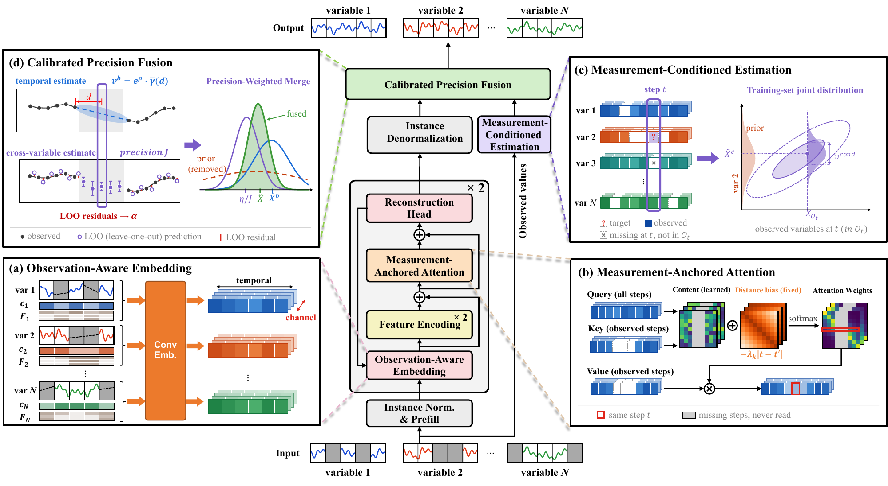

# Cairn: Observation-Anchored Calibrated Fusion for Multivariate Time-Series Imputation under Missingness-Pattern Shift

Cairn is a multivariate time-series imputer for settings where missingness patterns differ between training and deployment. This repository contains the implementation, five processed landslide monitoring datasets, and experimental results.

## Method Overview



The temporal backbone estimates missing values using attention anchored to observed time steps. Cairn then uses observations from other variables at the same time step to refine the estimate, with a correction weight calibrated within the current window.

## Results

- [Full results](results/main_results_full.md): MSE / MAE for all datasets, missingness patterns, and point-wise missingness rates.
- [Standard deviations](results/standard_deviations.md): SDs over five runs for the results in Tables 2 and 3 of the paper.

## Environment

```bash
pip install -r requirements.txt
```

## Data

`dataset/` contains five of the six landslide monitoring datasets used in the paper. Each file is a processed version of the original records, with native missing values kept as missing. If you use these data, please cite the original sources below and follow their licenses.

| File | Site | Source | License |
|---|---|---|---|
| `HH60.csv` | Hollin Hill, UK | British Geological Survey [1] | CC BY 4.0 |
| `NZUT.csv` | Utiku, New Zealand | GeoNet [2]; rainfall and snowfall from ERA5 [3] | CC BY 3.0 NZ (GeoNet); Copernicus terms (ERA5) |
| `PSMH.csv` | Hörnligrat, Matterhorn, Switzerland | Weber and Beutel [4] | CC BY 4.0 |
| `TT60.csv` | Two Towers, California, USA | U.S. Geological Survey [5] | Public domain |
| `TN15.csv` | Toro Negro, Puerto Rico | U.S. Geological Survey [6] | Public domain |

### XP60 (Xinpu, China)

The GNSS observations used for XP60 come from Zhang Qin, Huang Guanwen, Du Yuan, and Bai Zhengwei (2022), Chang'an University, *GNSS original observation data set of Xinpu landslide in Three Gorges from 2019 to 2021*. The National Earth Observation Data Center (NODA) record covers December 2019 to December 2021.

1. Open the [official dataset record](https://doi.org/10.11878/db.202206.006947), or search the [NODA data portal](https://noda.ac.cn/datasharing) for CSTR `10441.0.202206.006947`.
2. Sign in or register with NODA. The record lists **Apply offline** as its access method. Follow the application instructions on the record to request the original files under the provider's terms.
3. Use the files supplied by NODA as the raw GNSS source. The Cairn loader expects a processed hourly CSV with a `date` column at `dataset/XP60.csv`. The raw download requires preprocessing, and this repository does not distribute the prepared XP60 CSV.

### References

1. British Geological Survey (2024). Data used in manuscript "High-resolution geophysical monitoring of moisture accumulation preceding slope movement – a path to improved early warning". Zenodo. https://doi.org/10.5281/zenodo.13118624
2. GeoNet. Utiku landslide. https://www.geonet.org.nz/landslide/projects/utiku. We acknowledge the New Zealand GeoNet programme and its sponsors NHC, Earth Sciences NZ, LINZ, NEMA and MBIE for providing data/images used in this study.
3. Hersbach, H., Bell, B., Berrisford, P., et al. (2020). The ERA5 global reanalysis. *Quarterly Journal of the Royal Meteorological Society*, 146(730), 1999–2049. https://doi.org/10.1002/qj.3803
4. Weber, S., & Beutel, J. (2026). In-situ measurements in steep bedrock permafrost in an Alpine environment on the Matterhorn Hörnligrat, Zermatt Switzerland: 2008–2025. PANGAEA. https://doi.org/10.1594/PANGAEA.996196
5. Schulz, W. H., Smith, J. B., Wang, G., Jiang, Y., Deuell, A. E., Reeves, R. R., Handwerger, A. L., & Roering, J. J. (2018). Data from in-situ landslide monitoring, Trinity County, California. U.S. Geological Survey data release. https://doi.org/10.5066/F7GF0SFS
6. Smith, J. B., Thomas, M. A., Ashland, F., Michel, A., Mirus, B. B., & Wayllace, A. (2020). Hillslope hydrologic monitoring data following Hurricane Maria in 2017, Puerto Rico, July 2018 to June 2020. U.S. Geological Survey data release. https://doi.org/10.5066/P9548YK2

<details>
<summary>BibTeX</summary>

```bibtex
@misc{bgs2024hollinhill,
  author       = {{British Geological Survey}},
  title        = {Data used in manuscript ``High-resolution geophysical monitoring of moisture accumulation preceding slope movement -- a path to improved early warning''},
  howpublished = {Zenodo},
  year         = {2024},
  doi          = {10.5281/zenodo.13118624}
}

@misc{geonet_utiku,
  author       = {{GeoNet}},
  title        = {Utiku landslide},
  howpublished = {\url{https://www.geonet.org.nz/landslide/projects/utiku}}
}

@article{hersbach2020era5,
  author  = {Hersbach, H. and Bell, B. and Berrisford, P. and others},
  title   = {The {ERA5} global reanalysis},
  journal = {Quarterly Journal of the Royal Meteorological Society},
  year    = {2020},
  volume  = {146},
  number  = {730},
  pages   = {1999--2049},
  doi     = {10.1002/qj.3803}
}

@misc{weber2026matterhorn,
  author       = {Weber, Samuel and Beutel, Jan},
  title        = {In-situ measurements in steep bedrock permafrost in an Alpine environment on the Matterhorn H{\"o}rnligrat, Zermatt Switzerland: 2008--2025},
  howpublished = {PANGAEA},
  year         = {2026},
  doi          = {10.1594/PANGAEA.996196}
}

@misc{schulz2018trinity,
  author       = {Schulz, W. H. and Smith, J. B. and Wang, G. and Jiang, Y. and Deuell, A. E. and Reeves, R. R. and Handwerger, A. L. and Roering, J. J.},
  title        = {Data from in-situ landslide monitoring, {Trinity County, California}},
  howpublished = {U.S. Geological Survey data release},
  year         = {2018},
  doi          = {10.5066/F7GF0SFS}
}

@misc{smith2020puertorico,
  author       = {Smith, J. B. and Thomas, M. A. and Ashland, F. and Michel, A. and Mirus, B. B. and Wayllace, A.},
  title        = {Hillslope hydrologic monitoring data following {Hurricane Maria} in 2017, {Puerto Rico}, {July} 2018 to {June} 2020},
  howpublished = {U.S. Geological Survey data release},
  year         = {2020},
  doi          = {10.5066/P9548YK2}
}
```

</details>

## Usage

Train on one dataset and evaluate it under all missingness patterns:

```bash
python train.py --data TN15
```

Train and evaluate on the five datasets included in the repository:

```bash
bash run_all.sh
```

If you have a prepared local `dataset/XP60.csv`, run `python train.py --data XP60`.

Evaluate a trained checkpoint:

```bash
python evaluate.py --data TN15 --checkpoint runs/TN15/checkpoint.pth
```

The model is trained once under point missingness (rate 0.5) and evaluated without retraining under point missingness (rates 0.2, 0.4, 0.6, 0.8), block, subsequence and mixed missingness. Results are written to `runs/<data>/results.json`.
